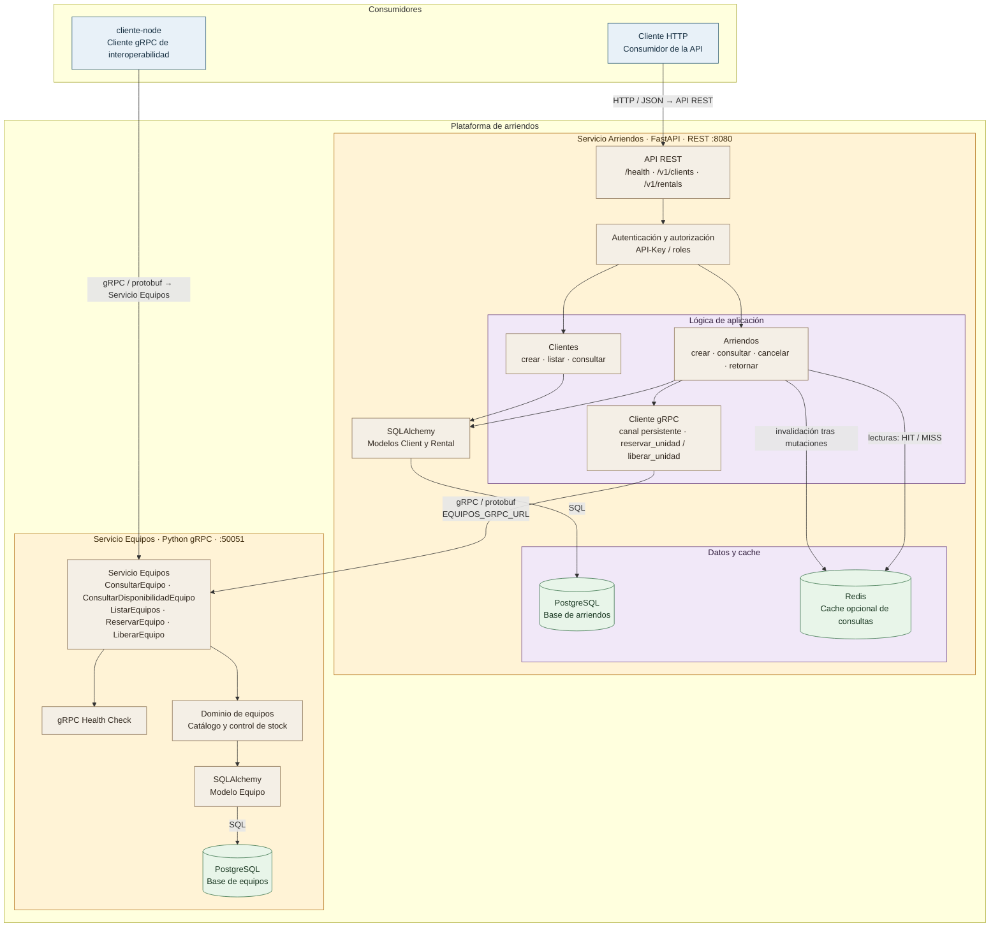

# Arquitectura y descomposición en servicios

## Flujos principales

- **Crear arriendo:** `Cliente HTTP -> arriendos-api -> PostgreSQL de arriendos` y, antes de confirmar, `arriendos-api -> equipos-api -> PostgreSQL de equipos` para reservar una unidad.
- **Cliente gRPC:** cada proceso de Arriendos reutiliza un canal y stub thread-safe; cada llamada conserva su timeout configurado y traduce los códigos gRPC a errores HTTP del contrato REST.
- **Consultar arriendos:** `arriendos-api` intenta resolver desde Redis cuando está activo; ante un `MISS`, consulta PostgreSQL y almacena el resultado durante 60 segundos.
- **Cancelar o retornar:** `arriendos-api` cambia el estado local mediante una actualización condicional de `ACTIVE` al estado final y confirma esa transacción antes de liberar la unidad mediante gRPC. Si Equipos rechaza la liberación, restaura el arriendo a `ACTIVE`; si falla la confirmación local, no intenta liberar la unidad. Esta compensación reduce inconsistencias, pero no equivale a una transacción distribuida.
- **Interoperabilidad:** `cliente-node` consume directamente el contrato `Equipos/equipos.proto` y prueba las operaciones gRPC del catálogo.

La separación de datos es por servicio: cada API posee su propia base PostgreSQL y el servicio Arriendos no accede directamente a la base de Equipos. La comunicación entre servicios se realiza exclusivamente mediante gRPC. En Compose solo se publica la API REST; gRPC y las bases de datos permanecen accesibles dentro de la red interna de contenedores.
